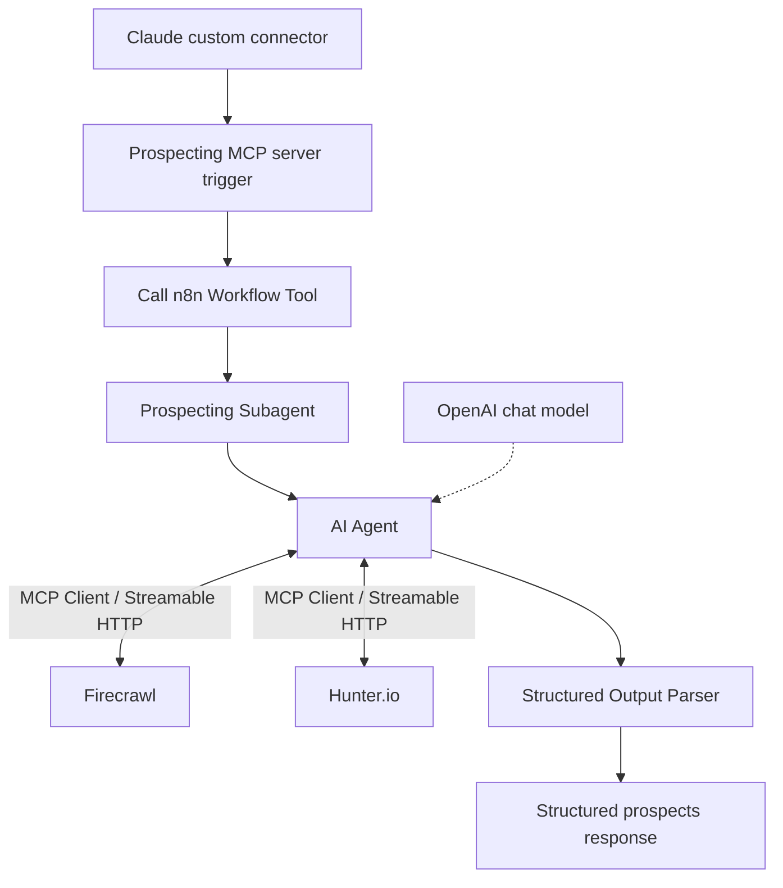

# AMPLIFY — Agentic AI Sales & Business Development Automation

**Status:** Phase I implemented, tested and published to production; Phase II RevOps and SDR components implemented and tested. Central orchestration planned.
**Project owner and implementation:** Wagner Stoffel  
**Domain:** B2B sales intelligence · Agentic AI · Business process automation

## Overview

I implemented an AI-driven B2B prospecting service that converts a natural-language sales objective into structured leads. It autonomously selects web research and contact-enrichment tools, identifies relevant decision-makers, and returns professional contact candidates and a qualification rationale. I configured, tested, refactored and deployed the workflows, including the external Claude integration.

This is a technical case study of a hands-on implementation based on a guided reference architecture, rather than a claim to have originated the underlying protocol or services.

## Project evolution

| Phase | Scope | Status |
| --- | --- | --- |
| I — AI Prospecting & MCP Integration | Firecrawl, Hunter.io, reusable prospecting agent and Claude integration | Implemented, tested and published |
| II — Business Development & Revenue Operations | Pipedrive CRM, RevOps, SDR, context engineering and human-reviewed Gmail drafts | Implemented and functionally tested |
| III — Business Development Orchestration | Central manager coordinating the subagents | Planned |

[Phase II — technical implementation and test record](docs/business-development-revops-sdr.md)

## Business objective

Reduce manual prospect research, improve contact-data quality and make prospecting reusable across applications. The service targets five relevant prospects per query, with a consistent machine-readable response. The expanded platform registers leads in Pipedrive and prepares Gmail drafts for human review. It does not automatically send outreach or guarantee email deliverability.

## Technology stack

| Component | Purpose |
| --- | --- |
| n8n | Workflow orchestration, AI Agent and MCP server |
| OpenAI | Language model and tool selection |
| Firecrawl | Web search and scraping |
| Hunter.io | Discovery, domain search, email finding and verification |
| MCP | Tool discovery and interoperable service access |
| Streamable HTTP | Remote MCP transport |
| Structured Output Parser / JSON | Output contract |
| Claude | External MCP host and end-to-end consumer |
| Pipedrive | CRM organizations, people and leads |
| Gmail | Human-reviewed HTML outreach drafts |

## Phase I — Prospecting and MCP architecture



MCP is used in both directions: the agent consumes external MCP tools, while the service exposes the complete prospecting workflow as a tool to another MCP host.

## Implementation

### 1. Environment and agent prototype

I organised the n8n project into prototyping and MCP folders, created a chat-triggered agent, connected a language model, and enabled structured outputs. The reference configuration used GPT-5.2 with low reasoning effort and raised the maximum iteration count from 10 to 30 to support multi-step inquiries. Simple Memory was initially used and then removed to make calls independent.

### 2. Firecrawl integration

I configured a remote MCP Client Tool using Streamable HTTP and a project-variable reference for the Firecrawl API key. The server supplies tool descriptions and input schemas so the model can choose between search and scrape without hard-coding the sequence.

The initial prospecting test revealed a practical limitation: general web research can return generic or uncertain email addresses.

### 3. Hunter.io integration

I added a second MCP Client Tool with Bearer Authentication. Email Finder, Email Verifier, Domain Search and Discover provide complementary capability. I revised the system instructions to request professional email identification and verification, and tested the combined agent.

The agent can use different tool sequences for equivalent queries; it is not required to scrape every website or call both providers on every run.

### 4. Structured output

The agent was instructed to identify five relevant prospects and return a consistent JSON object. Illustrative contract (synthetic values, not real lead data):

```json
{
  "prospects": [
    {
      "first_name": "Example",
      "last_name": "Contact",
      "company": "Example Consulting",
      "role": "Finance Director",
      "email": "contact@example.com",
      "rationale": "Relevant decision-maker for accounting software."
    }
  ]
}
```

Phase II adds independent CRM and draft-generation workflows. Spreadsheet and other database integrations remain potential extensions. Central coordination of prospecting and CRM operations is planned.

### 5. Reusable subagent

I replaced the chat trigger with **When Executed by Another Workflow**, defined a string input named `query`, and mapped it into the agent via `{{ $json.query }}`. I published the resulting **Prospecting Subagent** workflow.

### 6. MCP service and deployment

I built a separate **Prospecting MCP** workflow using **MCP Server Trigger** and **Call n8n Workflow Tool**. The tool description communicates the sales-prospecting purpose and allows the consuming model to supply the query. I published both workflows and configured Claude's custom connector with the production MCP endpoint.

## Testing and validation

| Scenario | Validation scope |
| --- | --- |
| Initial prospecting | Firecrawl connection, tool discovery, search/scrape and JSON output |
| Enriched prospecting | Hunter authentication, email finding, verification, domain search and dynamic tool selection |
| Subagent | Query mapping and independent execution through a calling workflow |
| Production MCP | Published endpoint, tool discovery and remote invocation from Claude |
| End-to-end | External query, subagent processing, structured response and n8n execution-log inspection |

The business test case targeted buyers of accounting software at US consulting firms. The implementation was tested and deployed by me. Exact call counts, latency, email accuracy, cost and conversion rates are not asserted without original execution logs. Email verification is probabilistic and does not guarantee delivery.

## Design decisions and limitations

- Prefer native n8n tools where they provide the required capability; use MCP for interoperability or additional tool coverage.
- Use remote Streamable HTTP for the integrations rather than local STDIO or legacy SSE.
- Allow dynamic tool selection while constraining the result format.
- Separate the service endpoint from the reusable business workflow.
- Treat third-party data and scraped content as untrusted; review contact accuracy and applicable privacy/outreach requirements before operational use.
- For operational exposure, configure server authentication, restrict access, monitor quotas and costs, and protect credentials. Hardening and load testing are not verified by this case study.

## Phase II — Revenue Operations and Sales Development

I extended the platform with two independently tested workflows: **RevOps Subagent**, which extracts structured lead data and creates linked organization, person and lead records in Pipedrive through deterministic nodes; and **SDR Subagent**, which reads CRM contacts and creates personalised HTML drafts in Gmail. I refined the SDR prompt and recipient mapping after reviewing the initial draft, then retested the corrected workflow.

I used context engineering to separate task-specific tools, and retained a human review step before external communication to reduce prompt-injection and disclosure risks. The components are implemented and functionally tested; the central Business Development Manager is planned. Deployment of the new workflows is reported by the project owner; explicit production publication records are not included.

[Read the Phase II architecture, mappings, test results and limitations](docs/business-development-revops-sdr.md).

## Repository scope

This repository documents the implemented project. Original n8n workflow exports, production endpoints, credentials, contact lists and execution logs are not included. The JSON example is illustrative, not an importable n8n workflow.

## Portfolio

[Wagner Stoffel — Project Management, AI & Automation](https://github.com/wagner-stoffel/portfolio)
