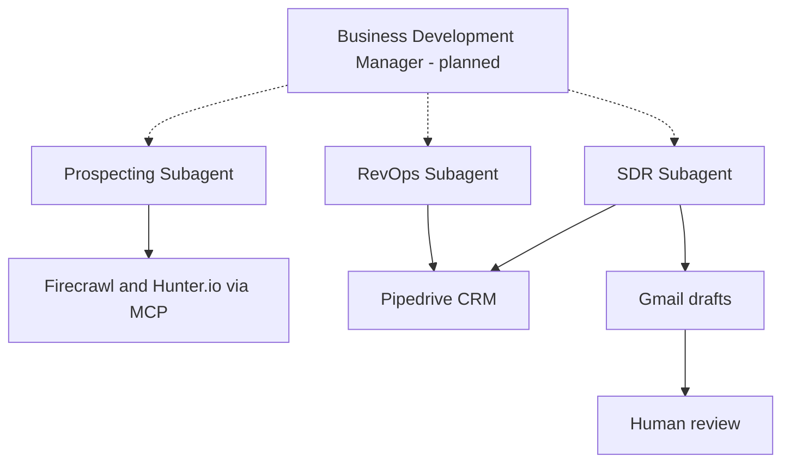
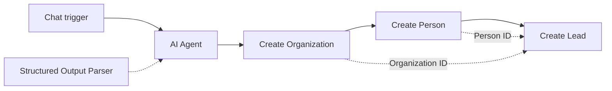
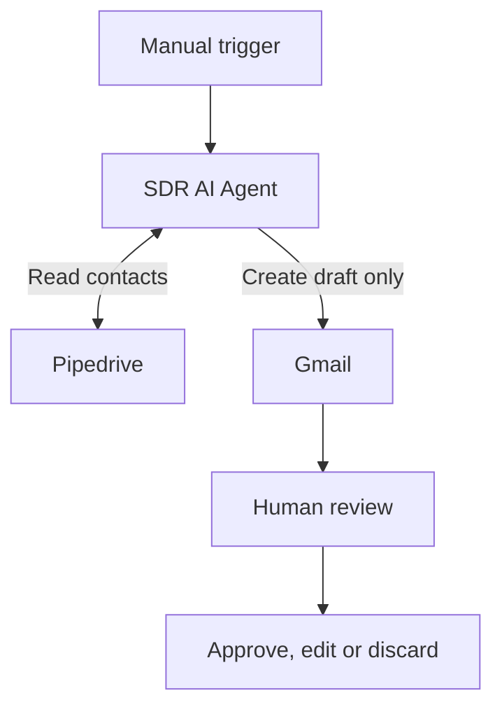

# AMPLIFY — Phase II: Business Development & Revenue Operations

**Implementation:** Wagner Stoffel  
**Status:** RevOps and SDR workflows implemented and functionally tested; deployment completed as reported by the project owner. Central Business Development Manager orchestration is outside this phase.

## Business problem

Extend the existing prospecting infrastructure into a commercial operations platform that reduces manual CRM administration and prepares personalised outbound communications for human review. The design reuses the Prospecting Subagent from Phase I and introduces two specialised workflows.

## Architecture



Dashed links represent the planned central orchestration, not an integrated end-to-end run in this phase. The three component workflows are independently testable.

## Context engineering and architectural decisions

I separated capabilities by task rather than simply replicating human job titles. The Prospecting Subagent retains its research tools; RevOps handles structured CRM writes; SDR reads contacts and generates draft communications. Independent workflows restrict the context and tool descriptions relevant to each task.

For operations with known dependencies, such as creating related CRM records, I chose structured output and deterministic workflow nodes. For tasks requiring language generation and variable tool use, such as preparing outreach, I used agent-driven tool calling. The design trades some autonomy for predictability and testability; improvements in token consumption or accuracy have not been benchmarked.

## RevOps Subagent — CRM record creation

### Configuration

I prepared a Pipedrive environment, removed sample data and configured the API credential in n8n. The reference agent configuration uses OpenAI GPT-5.2, low reasoning effort, no conversational memory and an enabled Structured Output Parser. The initial trigger is Chat Message.

The agent extracts four fields from a natural-language description of a lead:

```json
{
  "name": "Example Contact",
  "company": "Example Consulting",
  "role": "Chief Financial Officer",
  "email": "contact@example.com"
}
```

Illustrative data only. The prompt instructs the agent to structure the user-provided lead for subsequent CRM processing. The role field is extracted, but its persistence in Pipedrive was not demonstrated.

### Deterministic workflow



I evaluated native Pipedrive tools attached directly to the agent. The creation operations require an ordered sequence and mapping of returned identifiers. I therefore used three workflow nodes rather than relying on the model to manage that sequence.

| Source | Target |
| --- | --- |
| Agent output: company | Organization name |
| Agent output: name | Person name |
| Agent output: email | Person email |
| Agent output: name | Lead title |
| Create Organization: returned ID | Lead organization ID |
| Create Person: returned ID | Lead person ID |

Example expressions, dependent on the actual node names:

```javascript
{{ $json.output.company }}
{{ $('AI Agent').item.json.output.name }}
{{ $('Create an organization').item.json.id }}
{{ $json.id }}
```

### Functional validation

I first disabled the three CRM nodes to inspect the structured output from a demonstration lead. After mapping the fields and re-enabling the nodes, I reran the workflow and inspected the organization, person and lead records directly in Pipedrive. The reference scenario used a demonstration CFO contact at IBM; the lead was linked to the relevant organization and person. This validates the tested sequence, not duplicate prevention, transaction rollback or high-volume operation.

## SDR Subagent — draft-only outreach

### Configuration

I created a separate workflow with a manual trigger, an OpenAI chat model, low reasoning effort and no conversational memory. Unlike RevOps, this agent uses two tools directly:

| Tool | Operation |
| --- | --- |
| Pipedrive | Get Many Persons; retrieve contact records |
| Gmail | Create Draft; HTML message, model-defined recipient, subject and body |

The agent was instructed to read CRM contacts and prepare personalised commercial messages for the demonstration accounting-software business, AccountAI. No email-send tool was provided. The example prompt was refined to restrict claims to supplied product information and use the CRM email address as the recipient.



### Test and refinement

| Check | Initial run | Retest after correction |
| --- | --- | --- |
| Retrieve CRM person | Passed | Passed |
| Create HTML draft | Passed | Passed |
| Recipient populated | Missing | Corrected |
| Product claims limited to supplied information | Unsupported details generated | Corrected in reviewed sample |

The first workflow run completed successfully at the technical level, but the draft introduced unsupported product features and omitted the recipient. I refined the prompt and exposed the recipient field to the model, reran the workflow and inspected the resulting draft in Gmail. The revised sample was concise, correctly addressed and limited to the approved commercial information. Drafts were not automatically sent.

## Agentic AI security

I assessed the design against Simon Willison's Lethal Trifecta: access to private data, exposure to untrusted content and the ability to communicate externally. The CRM can contain private information and externally sourced data, so an agent with automatic email sending could expose information through prompt injection.

I restricted SDR to draft creation and retained human review before any external communication. This reduces the direct exfiltration pathway; it does not eliminate prompt-injection risk or replace access controls, credential protection, privacy review or security testing. No adversarial security tests are claimed.

## Evaluation and delivery

| Test area | Result in the documented scenario |
| --- | --- |
| Pipedrive authentication | Successful |
| Natural-language extraction and JSON structure | Successful |
| Organization, person and lead creation | Successful |
| CRM record associations | Inspected successfully |
| CRM retrieval and Gmail draft creation | Successful |
| Draft quality and recipient mapping | Corrected and retested |
| Automatic outbound email | Not enabled |
| Central manager orchestration | Planned for a later phase |

Future evaluation metrics include CRM data accuracy, draft approval rate, workflow success rate, cost per lead, latency, lead qualification and eventual conversion. No measured improvements or revenue results are asserted.

## Current project structure

```text
Amplify/
├── Prototyping/
├── MCP/
│   ├── Prospecting Subagent
│   └── Prospecting MCP
└── Business Development/
    ├── RevOps Subagent
    └── SDR Subagent
```

## Limitations and roadmap

The demonstrated RevOps process creates records directly; deduplication, existing-organization lookup, transactional error handling and retry policies are future improvements. SDR currently retrieves all contacts; segmentation, pagination, batch limits and consent checks are required before larger-scale use. A Business Development Manager coordinating the three workflows is planned, not documented as implemented here.

The project owner reports implementing, testing and deploying the components. Original execution logs, workflow exports and explicit publication records for the two new workflows are not included in the source material. Phase I's published MCP service is documented separately in the [main README](../README.md).

[Return to AMPLIFY](../README.md)
